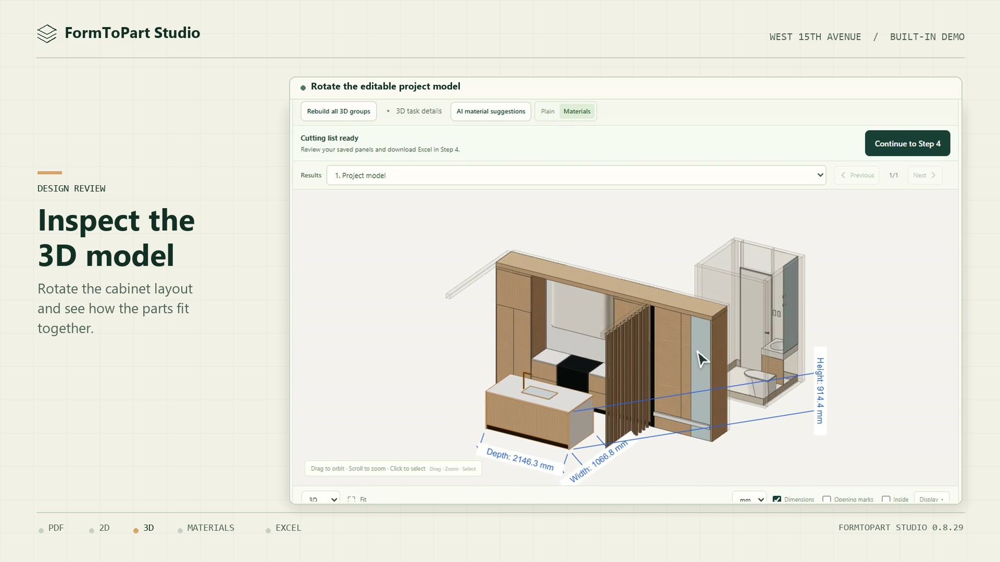
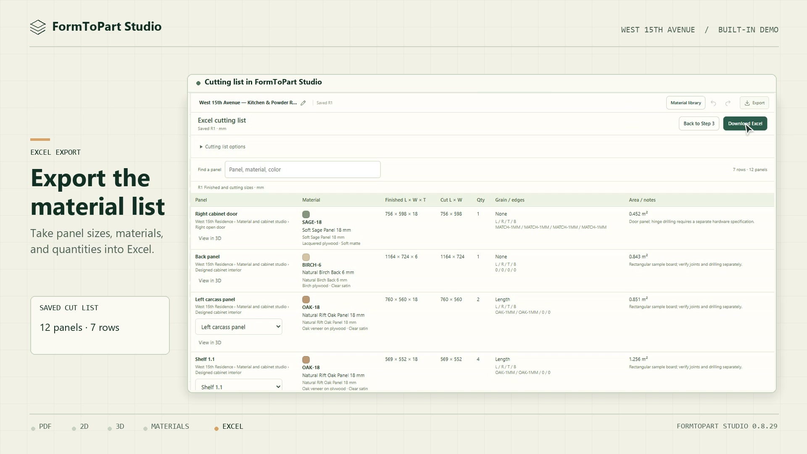

<div align="center">

# FormToPart Studio

### AI Drawing Review, 3D & Cutting Lists

Turn customer PDF drawings into a reviewable design workspace for interiors, cabinetry and millwork.


**[Windows app](https://github.com/zjxflyer/formtopart-studio/releases/latest/download/FormToPart-Studio.exe)** · **[Skills ZIP](https://github.com/zjxflyer/formtopart-studio/releases/latest/download/Codex-Drawing-Workflow-v7.zip)** · **[Source ZIP](https://github.com/zjxflyer/formtopart-studio/releases/latest/download/FormToPart-Studio-v0.8.29-Source.zip)** · **[Workflow handbook](Codex-skills/handbook/Drawing-Workflow-Handbook.pdf)**

</div>

https://github.com/user-attachments/assets/0d0b28b5-ad4d-494a-b571-b616db186abf

## From drawings to a shared design review

FormToPart Studio brings source PDFs, 2D drawings, editable 3D models, board materials and Excel cutting lists into a local Windows desktop workspace. This repository also includes **six reusable Codex skills** for coordinating source-based drawing work with separate creation and independent checking.

| Work with | What you can do |
| --- | --- |
| **Customer PDFs** | Open source pages and review the drawing evidence behind a project. |
| **Plans and elevations** | Build, inspect and amend 2D design views with AI-assisted drawing actions. |
| **Interactive 3D** | Explore and edit the design, inspect components and review the spatial arrangement. |
| **Materials and cutting lists** | Assign board materials and export an Excel list for the selected physical panels. |
| **Codex drawing workflows** | Map source views, coordinate creation and checking, record issues and preserve project progress. |

<table>
  <tr>
    <td width="50%"><a href="docs/images/design-review.jpg"></a></td>
    <td width="50%"><a href="docs/images/cutting-list.jpg"></a></td>
  </tr>
  <tr>
    <td align="center">Inspect model parts and dimensions</td>
    <td align="center">Inspect materials and export the cutting list</td>
  </tr>
</table>

## Choose your download

| Download | Start here if you want to… |
| --- | --- |
| **[Windows app](https://github.com/zjxflyer/formtopart-studio/releases/latest/download/FormToPart-Studio.exe)** | Run Studio and explore the built-in demo. The prebuilt app does not require Python, Node.js or the development build tools. |
| **[Codex skills ZIP](https://github.com/zjxflyer/formtopart-studio/releases/latest/download/Codex-Drawing-Workflow-v7.zip)** | Use the six drawing skills in Codex with your own source files. See [installation below](#start-with-the-skills). |
| **[Source ZIP](https://github.com/zjxflyer/formtopart-studio/releases/latest/download/FormToPart-Studio-v0.8.29-Source.zip)** | Inspect the complete published source or build Studio on Windows. See [build instructions](#build-on-windows) and [licensing](#review-scope-attribution-and-licensing). |

See **[all releases and assets](https://github.com/zjxflyer/formtopart-studio/releases)** for release notes and checksums.

## Try the Windows app

**Requirements:** 64-bit Windows and the Microsoft Edge WebView2 Runtime.

1. Download **[FormToPart-Studio.exe](https://github.com/zjxflyer/formtopart-studio/releases/latest/download/FormToPart-Studio.exe)** from the latest release. A [SHA-256 checksum](SHA256SUMS.txt) is included for verification.
2. Open the EXE. Studio 0.8.29 starts on the home screen.
3. Click **Open project**, or select **West 15th Avenue — Kitchen & Powder Room**, to open the bundled sample on page 1 of its original PDF.
4. Review the PDF pages, then click **Continue to Step 2** to explore the reviewed drawings. The sample also includes an editable 3D model and an Excel cutting list.
5. Choose **New project** to work with your own PDF. Configure your own OpenAI API key through the **Assistant settings** gear to enable AI drawing actions.

<details>
<summary>Local project storage and upgrading an older GitHub edition</summary>

The GitHub edition stores projects in `%LOCALAPPDATA%\VancouverWoodCarving\CabinetStudioGitHub\projects` by default.

If you previously opened the 0.8.27 GitHub edition, this update adds the corrected source PDF to the existing sample and preserves its saved revisions. If saved work refers to a region of the older illustration, that illustration remains available for those references.

The bundled `.vwc` sample contains the supplied redacted `Original-customer-design_A200+A202.pdf`. Its three pages cover A101 floor plans, the A200 kitchen and the A202 powder room. Linked 2D and 3D review assets are included beside the sample in `desktop-app/public-sample/`.

</details>

## Six Codex skills

The **[Drawing Workflow — Effective Version 7](Codex-skills/README.md)** package contains six skills, Create/Check/Summarize/Coordinate role instructions, portable helpers, validation evidence and a bilingual handbook. The skills are used in Codex chats independently of the desktop app.

| Skill | Use it for |
| --- | --- |
| [`drawing-workflow`](Codex-skills/skills/drawing-workflow/SKILL.md) | Coordinate multi-sheet projects, view mapping, creation, independent checks, issue repair and saved progress. |
| [`elevation-create-and-audit`](Codex-skills/skills/elevation-create-and-audit/SKILL.md) | Create and audit source-faithful customer-confirmation plans, elevations and sections. |
| [`drawing-add-objects`](Codex-skills/skills/drawing-add-objects/SKILL.md) | Insert or replace physical objects while preserving affected sizes, symbols and layout constraints. |
| [`drawing-separate-objects`](Codex-skills/skills/drawing-separate-objects/SKILL.md) | Extract an existing assembly into a standalone plan, elevation or section. |
| [`interior-drawing-standards`](Codex-skills/skills/interior-drawing-standards/SKILL.md) | Interpret drawing conventions with cited Canadian and Vancouver references. |
| [`drawing-3d-workspace`](Codex-skills/skills/drawing-3d-workspace/SKILL.md) | Build and audit editable 3D drawing workspaces and portable read-only HTML viewers. |

### Start with the skills

**Requirements:** Codex and Python 3.10+ for the verification and installation helper.

1. Download **[Codex-Drawing-Workflow-v7.zip](https://github.com/zjxflyer/formtopart-studio/releases/latest/download/Codex-Drawing-Workflow-v7.zip)** and extract the complete package to a stable folder.
2. Open the extracted folder in Codex. Read the **[handbook PDF](Codex-skills/handbook/Drawing-Workflow-Handbook.pdf)** or its **[editable Markdown version](Codex-skills/handbook/Drawing-Workflow-Handbook.md)**.
3. Paste the following request into Codex to install with the package's **[guarded installation procedure](Codex-skills/RESTORE.md)**:

```text
Install the six Codex skills from the extracted Codex-skills package in this
folder. Read its README.md, manifest.json and RESTORE.md first. Verify the
bundle fingerprint:
2e81cf779f9af8ff594bdbed35358e13cc72c3ecde92858ed0c8084b641732ae

Discover the correct skill installation directory. Inspect existing skills
and capture their current fingerprints. Use package-tools/bundle_tool.py
to install with a new verified external backup. Keep the package,
installation directory and backup separate and non-overlapping.
Preserve the frozen package, unrelated skills, existing learning history
and in-flight project data. Stop and report any failed check or active lock.
Verify the installed fingerprints and explain how to start a fresh chat
with $drawing-workflow.
```

You can verify the frozen package from this repository's root with Python 3.10+:

```powershell
python -B Codex-skills/package-tools/bundle_tool.py verify --snapshot Codex-skills --expected-bundle-fingerprint 2e81cf779f9af8ff594bdbed35358e13cc72c3ecde92858ed0c8084b641732ae
```

The [bundle helper](Codex-skills/package-tools/README.md) checks existing skill fingerprints and creates verified backups before applying changes. Keep the package, installation directory and backup in separate, non-overlapping locations. Preserve the frozen package unchanged; save later receipts outside it.

After installation, start a new Codex chat with your own source files, sheet manifest and project root. For example:

```text
Use $drawing-workflow for this project. Read the source PDFs and current
project state first. Map the source views, then create separate plans and
elevations for each sheet. Save progress and independently check the outputs.
Project root: <your project folder>
Source files: <your source PDFs>
Sheet order: <your sheet list>
```

The bookkeeping helper manages project records and delivery tasks. Actual drawing work still requires source inspection, drawing tools and independent review.

## Build on Windows

Install **Python 3.13 x64**, **Node.js 24**, **pnpm 10.15.1** and **.NET Framework 4.8**. From a PowerShell window at the repository root, run:

```powershell
.\build.ps1
```

The build restores pinned dependencies and the Microsoft WebView2 SDK, compiles the Studio interface and standalone 3D viewer, and packages the Windows host. Use `-Python` or `-Pnpm` to specify an executable path. The output is `desktop-app/dist/FormToPart-Studio-v0.8.29-GitHub.exe`.

<details>
<summary>Run the packaged native self-test</summary>

This check creates a small synthetic project and writes a JSON receipt in a new temporary directory.

```powershell
$app = (Resolve-Path 'desktop-app/dist/FormToPart-Studio-v0.8.29-GitHub.exe').Path
$testDir = Join-Path $env:TEMP ('FormToPart-self-test-' + [guid]::NewGuid().ToString('N'))
New-Item -ItemType Directory -Path $testDir | Out-Null
$receipt = Join-Path $testDir 'studio-self-test.json'
Start-Process -FilePath $app -ArgumentList '--native-self-test-output', ('"{0}"' -f $receipt) -WindowStyle Hidden -Wait
Get-Content -LiteralPath $receipt
```

</details>

## Verification

[Recorded release verification](BUILD-VERIFICATION.md) documents **21 native self-checks** and **39 startup, navigation and package checks** for release 0.8.29, together with earlier source-replacement, sample-upgrade and export checks.

The Codex package has its own [validation summary and limitations](Codex-skills/evidence/validation-summary.json). Workflow tests demonstrate the tested workflow behavior and do not establish customer acceptance or error-free drawing generation.

## Project layout

```text
.
├── Codex-skills/          Six skills, handbook, guarded installer and evidence
├── desktop-app/           Windows host, Python service and bundled sample
├── frontend/              Studio interface and 3D workspace
├── docs/images/           Product video poster and screenshots
├── third-party/           Dependency notices and license material
├── build.ps1              Windows build entry point
├── BUILD-VERIFICATION.md  Recorded release checks
└── SHA256SUMS.txt         Release executable checksum
```

The executable is distributed through **[GitHub Releases](https://github.com/zjxflyer/formtopart-studio/releases)**; it is excluded from the source tree.

## Review scope, attribution and licensing

Studio and the skills support design review and customer-confirmation work. Drawing outputs, 3D models and exported cutting lists require appropriate checking before use; they do not establish fabrication acceptance. Source uncertainties and unresolved production details must be resolved for the intended job.

The sample architectural design is credited to **STRUC DESIGN AND BUILD LTD**. The supplied redacted customer PDF and derived review assets retain their third-party origin. Attribution does not establish permission to publish or reuse that material; this repository does not grant third-party drawing rights.

This snapshot contains **no separate license grant for the application source or included skills**. Public availability does not by itself grant reuse or redistribution rights. Dependency licenses and acknowledgments are listed in **[THIRD_PARTY_NOTICES.md](THIRD_PARTY_NOTICES.md)** and `third-party/`.

For questions or reproducible problems, **[open an issue](https://github.com/zjxflyer/formtopart-studio/issues)** and include the Studio version, steps to reproduce and relevant redacted screenshots.
